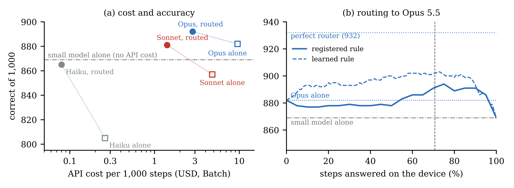

# A 149M Text Encoder as the First Tier for Phone Agents: Pre-Registered Routing to Frontier Models

Paper: [`paper/main.pdf`](paper/main.pdf). The model is released as **Milo Pointer**.

- **A 149M text-only model scores 86.1% on AndroidControl-Low** under the protocol screenshot agents report, above the 85.2%
  reported for OS-Atlas-7B (step sets differ slightly).
- **Small model + frontier beats the frontier alone.** The small model answers about 70% of steps on the device and hands the
  rest to Claude Opus 5.5. In a pre-registered confirmatory test routing beat Opus alone by 2.8 points (p = 0.003); pooled over
  all 1,650 test steps the gain is 1.5 points (95% CI [+0.5, +2.4]), at under a third of Opus's API cost.
- **What did not work is documented too.** About 40 registered experiments, negative ones included, with timestamps
  (`paper/PREREGISTRATION.md`).



A 149M-parameter local model answers the phone-agent steps it is confident about and hands the rest to a frontier model.
On 1,000 held-out AndroidControl steps (offline, one step at a time, pre-registered):

| System | Run 1 | Run 2 | Steps on device | API $ per 1k steps (Batch) |
|---|---|---|---|---|
| Small model alone (149M) | 869 | 869 | 100% | 0 |
| Claude Opus 5.5, 16 retrieved examples | 882 | 879 | 0% | 9.54 |
| **Small model, then Opus when unsure** | **892** | **890** | **70.7%** | **2.82** |
| Claude Sonnet 5.5, 16 retrieved examples | 857 | 862 | 0% | 4.80 |
| **Small model, then Sonnet when unsure** | **881** | **889** | **70.7%** | **1.41** |

A further registered test on 650 steps from test episodes used in no earlier sample, with a learned hand-off rule frozen beforehand, found routing to Opus
**more accurate than Opus alone: 599 vs 581 (+2.8 points, 95% CI [+1.0, +4.5], p = 0.003)**, with 73.7% of steps answered locally
(`python bench/ac_confirm_score.py`, needs numpy).

Limits: offline single steps with a human-written step instruction; a comparable cascade lost on live AndroidWorld tasks; the small
model alone is not better than Opus given the same examples; on a Pixel 6a CPU the model takes a median 3.4 s per step.
Details in [`paper/main.pdf`](paper/main.pdf).

## Contents

| Path | What |
|---|---|
| `paper/` | Paper (PDF, LaTeX), figures, and `PREREGISTRATION.md`: every hypothesis with its timestamp, written before the data were scored |
| `release/milo-pointer/` | The model's Python interface (`milo_pointer.py`), model card, parity check; weights: Hugging Face link added at release |
| `release/milo-pointer/android/` | ONNX export, on-phone benchmark (ONNX Runtime via `app_process`, no APK), live phone demo and its recording |
| `bench/` | Frontier harnesses (`ac_frontier.py`, `ac_fewshot.py`), routing and re-scoring scripts, step samples |
| `bench/results/` | Per-step outputs of every Claude run, and billed token counts |
| `training/` | Training script (`ac/pointer_v2/src/v2.py`), clean-protocol retrain, dataset builder notebook, frozen per-step outputs and confidences of the small model |

## Reproduce the headline numbers (no model calls, no cost)

```
./reproduce.sh          # standard library only
pytest -q tests         # asserts every headline number and registered outcome
```

Re-scoring on AndroidControl-Curated labels and re-running Claude need the AndroidControl text file
(`training/ac/androidcontrol_text.jsonl.gz`, built from the public AndroidControl release by `training/kaggle_ac/androidcontrol_text.ipynb`),
`pip install -r requirements.txt` and, for Claude, an Anthropic API key (the Claude arms cost money).

## Use the model

```python
from milo_pointer import MiloPointer
m = MiloPointer.load("milo-pointer")           # folder with model.safetensors
a = m.predict(goal, instruction, elements, width, height, last_step="new step")
if a["defer"]:
    ...  # send this step to your frontier agent
```

## License

Code: Apache 2.0. Model: Apache 2.0, fine-tuned from ModernBERT-base (Apache 2.0) on AndroidControl (Apache 2.0).

## Citation

Chaitanya Talapalli. A Small First Tier for Phone Agents: A Pre-Registered Offline Study of Routing Steps to a 149M Local Model. 2026.
